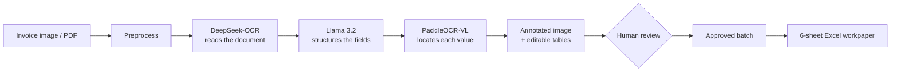

# Automated Invoice Processing

A 100% local desktop app that extracts data from invoices with a three-model AI pipeline, lets a human verify every value against the source document, and exports an audit-ready Excel workbook.

Built with Python and PySide6. No invoice data ever leaves your machine.

<!-- TODO: add a screenshot or short GIF of the review screen (bounding boxes + pink/green flags). Use a fake or blurred invoice, never real company data. Put it here, directly under the intro. -->


---

## Why I built it

<!-- TODO: 2-3 sentences in your own words. What problem did you notice during your internship (without naming the company or sharing confidential details)? Example structure: "Reviewing supplier invoices was done by hand, which is slow and error-prone. I wanted to see whether a local AI pipeline could do the extraction while a human keeps control of the final numbers." -->

---

## Highlights

- **100% local, no API fees.** Runs entirely on your machine, so invoice data stays private.
- **Human-in-the-loop review.** Every extracted value is mapped back to the invoice image with bounding boxes. Pink flags mark values the AI could not locate. Green marks show values you edited.
- **Audit trail.** Manual edits are logged and exported to Excel (6 sheets, including "Needs Review" and "Changes").
- **Built for modest hardware.** Automatic model swapping keeps the pipeline within 8 GB of VRAM, at about 20 seconds per invoice (see [Performance](#performance)).
- **Crash isolation.** One failed invoice does not stop the batch.
- **Portable.** Standalone Windows build (no Python needed) and self-contained session files you can save and reload.

---

## How it works



1. **DeepSeek-OCR** reads the document.
2. **Llama 3.2** turns the text into structured fields using an editable schema.
3. **PaddleOCR-VL** finds where each value sits on the page, so values can be matched to the correct row.
4. The app draws **yellow boxes** (invoice details) and **green boxes** (line items) on the image.
5. You review, edit and approve each invoice, then export.

Models are loaded and unloaded automatically so that the pipeline fits in 8 GB of VRAM.

---

## Getting started

### Requirements

- [Ollama](https://ollama.com) installed and running
- A GPU with 8 GB of VRAM
- Windows (tested on: <!-- TODO: Windows version -->)

### Option 1: Standalone Windows build

1. Download the portable folder and place it anywhere on your machine. No Python installation is needed.
2. Make sure Ollama is running (the app checks on startup).
3. Launch the `.exe`. The schema, sounds and GIFs sit next to it and can be edited.

### Option 2: Run from source

```bash
# 1. Install dependencies
pip install -r requirements.txt

# 2. Pull the models
# TODO: replace with the exact commands/model names you use, e.g.
# ollama pull <deepseek-ocr model name>
# ollama pull llama3.2
# ollama pull <paddleocr-vl model name>

# 3. Run the app
# TODO: exact command, e.g. python main.py
```

<!-- TODO: add Python version, e.g. "Python 3.11+" -->

---

## Usage

1. Click **Upload** and select your invoices (<!-- TODO: supported formats, e.g. PDF, JPG, PNG -->).
2. Click **Process**.
3. Open each invoice in the sidebar, check the highlighted values against the image, and fix anything wrong.
4. Approve invoices one by one.
5. Click **Approve Batch & Save** to export the Excel workbook.

Sessions can be saved and reloaded later as portable ZIP files.

---

## Excel output

One workbook per batch, with six sheets:

| Sheet | Contents |
|---|---|
| All Invoices | One color-coded block per invoice, with details and line items |
| Items | One row per line item |
| Details | One row per invoice |
| Needs Review | Invoices with unresolved flags and the specific cells |
| Changes | Audit trail of every manual edit (edited cells highlighted green) |
| Failed / Manual | Crashed or empty extractions, for accountability |

<!-- TODO: add a screenshot of the Excel output, using fake data -->

---

## Testing and results

<!-- TODO: fill with your real numbers. Only write what you measured.
- How many invoices did you test?
- How many were deliberately low quality (blurry, skewed, dark)?
- What share of fields were extracted correctly / flagged / wrong?
Example format: "Tested on 40 invoices, including 12 degraded scans. 91% of fields were correct without edits, 7% were flagged for review, 2% were wrong and unflagged." -->

### Performance

- About **20 seconds per invoice**, measured on: <!-- TODO: GPU model, RAM, CPU -->
- Designed to run within **8 GB VRAM**.

---

## Limitations

<!-- TODO: be specific and honest. This section makes the project more credible, not less. Consider:
- Languages and invoice layouts you have / have not tested
- Handwritten invoices
- Very long or multi-page documents
- What the app does when values cannot be located (it flags them, it does not guess)
- Is a human reviewer always required? -->

- This tool assists review. It does not replace it: AI extraction can be wrong, which is why every value is shown against the source and unlocated values are flagged.

---

## Privacy and data handling

- All processing runs locally through Ollama. No external API calls, no cloud upload.
- Session files are stored locally in a self-contained ZIP (review state, schema, annotated images).
- Session saves are written to a temporary folder first and then zipped, to avoid corrupted files.
- A version check prevents loading incompatible session archives.

---

<details>
<summary><b>Full feature list</b></summary>

### Core extraction
- Three-model pipeline (OCR, structuring, value location)
- Row-anchored value location that matches each value to the correct invoice row
- Annotated output image (yellow boxes for details, green for line items)
- Fuzzy matching that survives OCR typos and formatting variations
- Numeric cleaning (strips `$`, `,`, `USD`)

### Model lifecycle and VRAM management
- Automatic model swapping (Llama + Paddle unload before DeepSeek loads, and vice versa)
- DeepSeek preloads at startup and reloads after each batch, so the next batch starts instantly

### Review interface
- Zoomable image viewer (mouse wheel zoom, `Ctrl+0` to fit)
- Editable mini-Excel tables: double-click to edit, add or remove rows and columns
- Per-invoice review from the sidebar
- Pink flags for values the AI could not locate; green flags for manual edits
- Per-invoice undo/redo (`Ctrl+Z` / `Ctrl+Y`) that persists when switching invoices
- Sidebar status icons: ☐ New, ✏️ Edited, ❓ Empty, ⚠ Failed, ✓ Approved
- Right-click menu to approve, remove or add invoices
- Individual approval before export

### Batch workflow
- Add or remove invoices mid-session without losing existing edits
- Already-processed files are skipped when you click Process again
- Blank pages and failed extractions are detected automatically
- Every invoice gets an editable table even if extraction produced nothing

### Sessions
- Save / Save As / overwrite save
- Portable session ZIPs, restored in a fresh launch
- Timestamped, versioned filenames
- Optional cleanup prompt on export

### Excel export styling
- Pink fills for unresolved flags and green fills for edited values preserved
- Distinct pastel colors per invoice (adjacent invoices always differ)
- Red headers for flagged invoices, orange headers for empty extractions
- Borders on all cells, frozen header rows and autofilters on flat sheets

### Preferences and interface
- Configurable default folders for exports and session saves
- Built-in schema editor for the Llama extraction prompt, with a backup file (`schema_backup.txt`) to reset it
- Light and dark mode
- Animated progress overlay with phase labels, a weighted progress bar and optional audio cues

### Safety and robustness
- Startup checks with clear errors if Ollama is not running or the schema file is missing
- Crash isolation: failed invoices are tracked in the sidebar and excluded from the default export

</details>

---

## License

MIT License.
